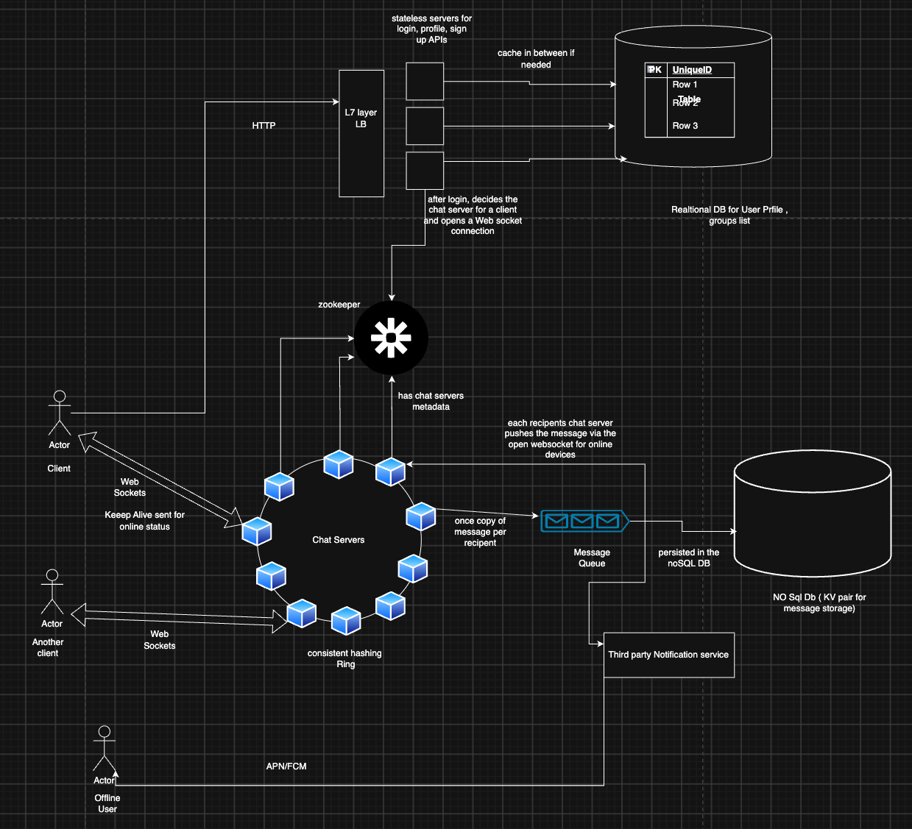

**Question**
Design a 1-to-1 and small group chat system (up to 100 members) with online presence, multi-device sync, and push notifications.
numbers: 50M DAU, groups with 100 members, and histroy retained forever

**Requirments**
1. assume 20% current online = 10M  = No of concurrent Websocket Connections, decet assumption of 50K webscokets fro each server then we have = (10*10^6)/(50*10^3)  = 200 chat servers
2.  message volume = 50 M DAU * 40 msg per day  = 2 B msg/day = avg  23K msg/sec , consider peak of 50K msg's
3. for user online status we can have the client send a Keep alive packet via the webscoket every 5 sec's , and if the keep alive packet is not being sent by the client then we mark the user inactive. and publish the stats to friends using the pub sub channels
4. Diff scale:- for APIS like sign up, login, profile, Group CRUD we willl have a separate fleet of hosts ( different from the current Chat Servers) runnning stateless applications. Why this separtaiton:- 1. chat servers have stickey connections (due to the websockets), so scaling becomes difficult, for these APIs we can scale up/down horizontally and also we can use normal Https connection for these calls and need not have a Web socket for the same.
5. since we have 200 chat servers we need something like Apache Zookeeper for clients to discover services and open a websocket connection based on geo, load and health 
6. For Websocket connextion load balanciong we will use Consistent Hashing, to avoid multiple connections change when eother 1 server is doen or a new server is added. For details of Consisten hagshing: understand that we will use a circular array with index of 0 to M-1 and 0 again in a circular fashion, then we will place Servers on indexes of his circular array ( calculated by passing the server Id to a hash fucntion), one server can be kept at K different locations on the array ( K different hash functions), then each web socket will have a ID that will be hased to get one index on the circular array and it will attached to the server nearest n the clockwise direction on the circular array. In that way even if a server dies its current web sockets are evenky distributed onto other servers. And if a new servr is added , very few connection sfrom each server is disurbed, in that we maintain the stickiness 
7. For HTTP request to Statless Servers we can use a normal round robin or Max Connextions kind of a Load balancer.
8. for a group message, chat server will publish one copy of the message per recipient to a Async queue, and eachg recipients chat server will publish it dorectly to online client.
9. for offlien clients we will use Apple push Notification Service ( APNs) ro FCM (Firebase Cloud Messaging) these thrid party service for push notifications when the device comes online.

**HLD FLOW**
1. User Login's  usng Https and application server, then the application server identifies the best chat server for it using the zookeper, client opens Websocker connection to it.
2. 1-1 chatting: User A sends a msg, its chat server recives it,  writes to the message queue, KV store persists it , if B is online message relays to B's chat server, if offline, push notification wales B vis APN/FCM
3. group send:- A sned a message in a group of 30 ppl --> one copy of message sen to queue/inbox of each user and then delivered in the same way

**Design Choice**
1. Web socket oer Http client pooling, allows rela time bi directional communication bteween client and server, avd of Web Sockets is reduces the number of get/read Http calls, but disavd of websocktes is tickkiness to a server can cause downtime/llag during rolling deployemnt ---> handeled with consistent hashing
2. No sql DB for message :- Group chat is basically like a log of messages we keep appending for each new message, will be complex to maintain in RDBMS
3. DNS with TTL v/s zookepper discovery:- choose zookerper discovery as it give sub secnond service discovery and status to re-route any web sockets,

**Optional**
For media upload we will use Blob storage -.Object Storage for photos/videos/voice.