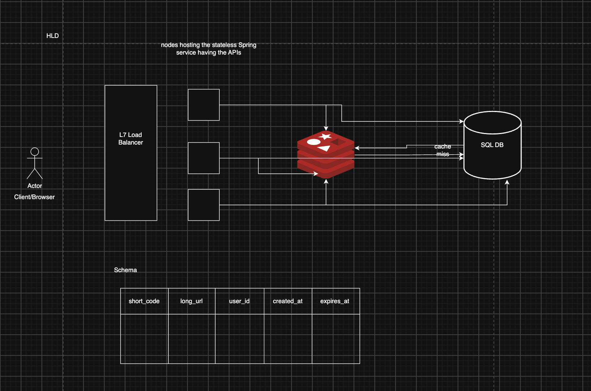
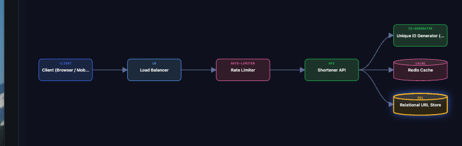

**Question**:
URL shortner, with 10 redirects: 1 new URL shortneded ration.
100 million new links per day and 1 billion redirects per day.
sub-50ms p99 redirect latency.
have analysistic and throttling also 

**Requirments**:
1. Loung URL --> 64 bits unique Hash---> base 62 encoding to genearte a unique 7 charatecerts URL.
2. Store the 7 characters along siode the long URL ( Writes in the system)
3. Redirect request from short URL to the long URL , HTTP code 301/302 (Reads in the system) --> will need a cache for reads, 
4. Scale given in question for writes = 100 million new links per day = (10^2* 10^6)/(24*60) write per minute = approx 70 K writed per minute = 1.2K writes per secod
5. scale given in question for reads = 1 billion  = (10^3*10^6)/(24*60*60) RPS = approx 11.6 K  reads per second
6. give HTTP 401 for revoked URLS
7. Idempotency ( per user, per url ) --> same outut code for same input code
8. Async pipeline to emit metrics/analystics to anotehr service 
9. Admin Service to revoke URL by flipping revoked_at flag that the cache treats as a neg entry with 60 s TTL.

**APIS**:
1. POST/shorten -->accepts URL and returns a short code
2. GET/<code> --> issues a HTTP 302 redirect to the original URL 

Resoucre level code

@PostMapping(value = "/shorten", consumes = "application/json", produces = "application/json")
    public ResponseEntity<ShortenResponse> shorten(@Valid @RequestBody ShortenRequest req,
                                                   @RequestHeader(value = "X-User-Id", required = false) String userId) {
        UrlMapping mapping = service.createShortUrl(req.getLongUrl(), userId, req.getCustomAlias());
        ShortenResponse body = new ShortenResponse(mapping.getShortCode(), mapping.getLongUrl(), mapping.getExpiresAt());
        return ResponseEntity.status(HttpStatus.CREATED).body(body);
    }

    @GetMapping("/{code:[0-9a-zA-Z]{7}}")
    public ResponseEntity<Void> redirect(@PathVariable String code) {
        Optional<String> longUrl = service.resolve(code);
        if (longUrl.isEmpty()) {
            return ResponseEntity.status(HttpStatus.GONE).build();
        }
        return ResponseEntity.status(HttpStatus.FOUND)
                .cacheControl(CacheControl.noStore().cachePrivate())
                .location(URI.create(longUrl.get()))
                .build();
    }

BL code for POSt and GET APIs

@Transactional
    public UrlMapping createShortUrl(String longUrl, String userId, String customAlias) {
        validator.requireSafe(longUrl);
        //generate short code
        String code = (customAlias != null) ? claimAlias(customAlias) : Base62Encoder.encode(idGen.nextId());
        //write to DB
        UrlMapping mapping = new UrlMapping();
        mapping.setShortCode(code);
        mapping.setLongUrl(longUrl);
        mapping.setUserId(userId);
        mapping.setCreatedAt(Instant.now());
        mapping.setExpiresAt(Instant.now().plus(DEFAULT_EXPIRY));
        //write to Redis with Expiry
        repo.save(mapping);
        redis.opsForValue().set(cacheKey(code), longUrl, CACHE_TTL);
        return mapping;
    }

    public Optional<String> resolve(String code) {
        //read from redis
        String cached = redis.opsForValue().get(cacheKey(code));

        if (cached != null) return Optional.of(cached);
        //if not found in cache read from DB
        Optional<UrlMapping> hit = repo.findByShortCode(code);
        //write to cache
        hit.ifPresent(m -> redis.opsForValue().set(cacheKey(code), m.getLongUrl(), CACHE_TTL));
        return hit.map(UrlMapping::getLongUrl);
    }

**HLD**
1. We will choose unique monotonic ID + base 63 encdoing instead of Hashing:- the 64 bits uniquq ID will have 41 bits timestamp + 10 bits machine + 12 bist seq
2. Each response for cliscking the short URL in the browser will be 302 redirect with Cache-Control: private, max-age=0 such that the browser does not store in the browser cache and the GET call always reached the server for analytics.
3. Cache population must be Write through during create and lazy on read miss. TTL set so that less frequently used ones are evicted from the cache
4. LB algoruthm: Round-robin with least-connections fallback. Healthy pool only; ejection after 3 consecutive 5xx within 10s. TLS termination ( default for L7 layer LB) ; plaintext HTTP to the API tier  --> can make LB choke point --> conside NLB if very high  traffic

**More read about**
1. RATE limiting techqiunes
2. Async pipelines to push analytics data 